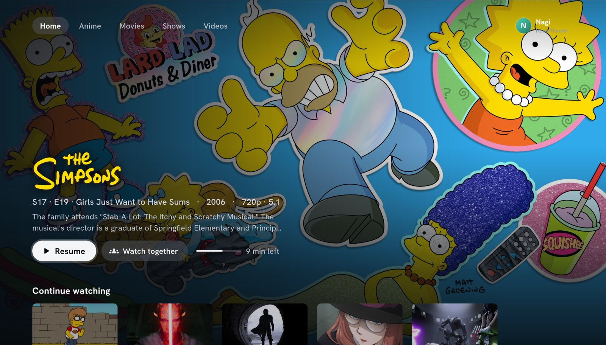
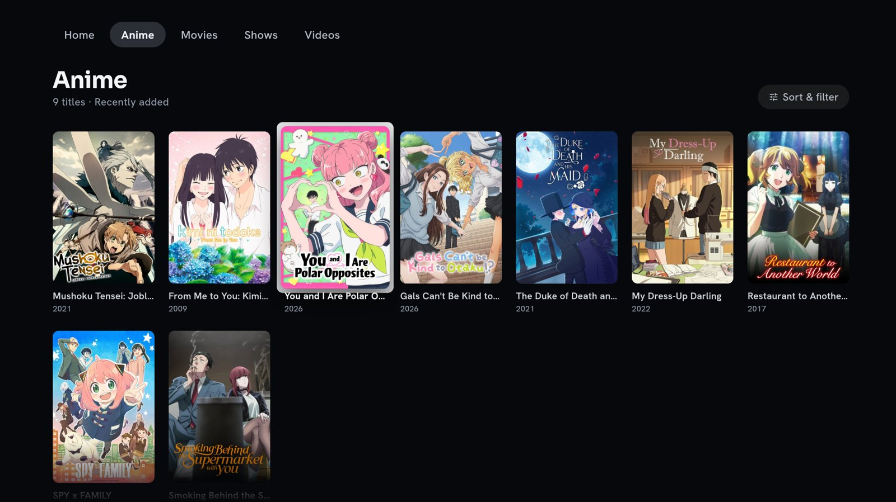
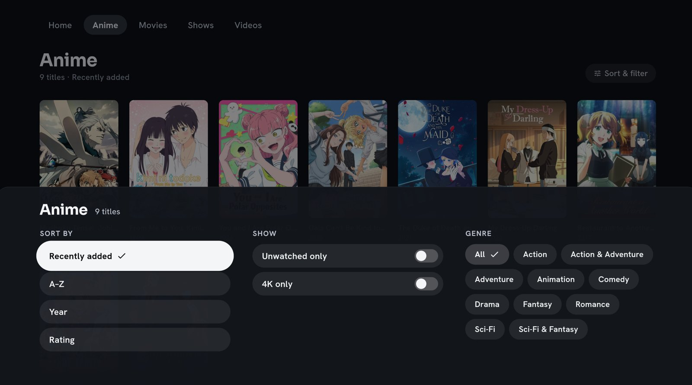
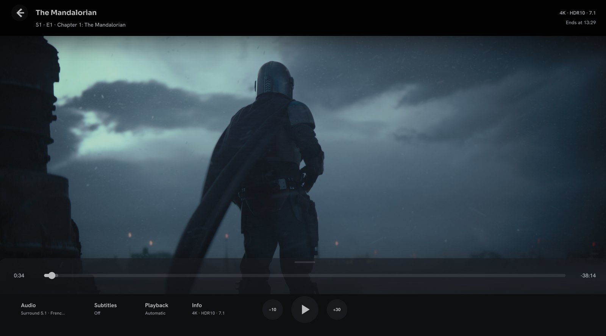
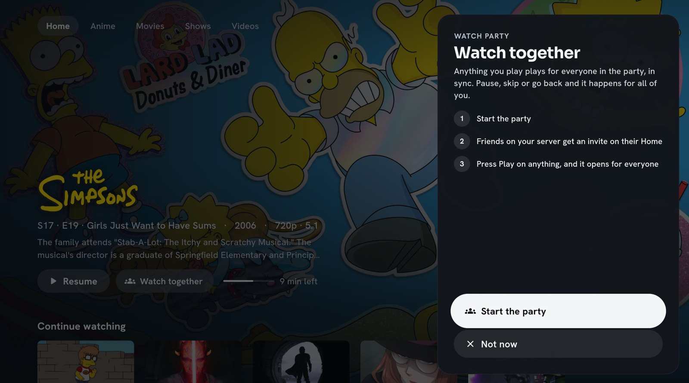

  <picture>
    <source media="(prefers-color-scheme: dark)" srcset="docs/logo/icon.svg">
    <source media="(prefers-color-scheme: light)" srcset="docs/logo/reverse.svg">
    
  </picture>

<h1 align="center">Frame</h1>

<b>Your Jellyfin library, the way a console would show it.</b>

Frame is a couch-first app for **Jellyfin**: full-screen artwork, big readable menus, made for a
**controller** but just as good with a mouse and keyboard. It plays your original files straight
from your server, in the best quality your screen can show, **4K, HDR and Dolby Vision included**.
Watch together with friends in sync, pick up where you left off, and never fight a tiny menu from
the couch again.

> **Status:** 0.3 is in testing on Linux and Windows. Try a build from [Releases](../../releases)
> and tell us what breaks: [report a bug](../../issues/new?template=bug_report.yml) or
> [suggest an idea](../../issues/new?template=feature_request.yml). Progress toward 0.3:
> [milestone](../../milestone/1).

## A quick look

| | |
|---|---|
|  |  |
| **Libraries** with big posters, made to browse with a controller | **Sort & filter** in one sheet: sort, unwatched only, 4K only, genres |
|  |  |
| **The player** shows what's playing at a glance: audio, subtitles, quality | **Watch parties**: anything you play opens for everyone, in sync |

## Why Frame

- **It feels like a console, not a website.** Full-screen artwork, a white ring on whatever's
  selected, menus that slide up from the bottom like on a PS5. Everything is readable from across
  the room.
- **Made for controllers.** PlayStation, Xbox and Steam controllers work out of the box, with a
  button guide that matches the one in your hands. Mouse and keyboard work everywhere too.
- **Best-quality playback.** Plays the original file directly (4K, HDR, Dolby Vision, TrueHD /
  Atmos, DTS; SRT, ASS and PGS subtitles) and quietly switches to your server's converted version only
  when a device can't keep up.
- **Seamless from Play to picture.** The loading screen looks like starting a game: artwork, logo,
  where you'll resume. Then it opens straight onto the video.
- **Watch together.** Start a party and friends get an invite on their Home. Pause, skip or go
  back and it happens for everyone. The party stays together from one episode to the next.
- **It remembers you.** Your audio and subtitle choices per show, where you stopped, which episode
  is next, synced with Jellyfin so every other app agrees.
- **Your server, your library.** Frame is just a better way to watch what you already have:
  nothing to migrate, works with your existing Jellyfin users, and you can keep using the official
  apps alongside.

## Features

- **Console-style Home.** Continue watching (with your next episode ready), Recently added, and one
  tab per library (Movies, Shows, Anime…).
- **Who's watching.** Profiles like a console, with Quick Connect sign-in (approve a code from your
  phone, nothing to type) or a password with an on-screen keyboard.
- **Show pages.** Seasons and episodes; the selected episode's full summary shows above the row.
- **The player.**
  - A see-through bar with Audio, Subtitles, Playback and Info, each showing what's in use.
  - Big track cards, subtitle size / position / background, and an Info tab with the episode
    and every technical detail (codec, HDR, decoder, buffering, dropped frames).
  - **Up next** card at the credits: the next episode starts after a short countdown, across
    seasons.
- **Remembers your audio and subtitles** per show, like Infuse (language, forced, SDH).
- **Watch parties** with invites, a party menu showing who's in and what they're watching, and
  Frame-to-Frame sync that keeps everyone together.
- **Several servers.** Your own and a friend's, each staying signed in.

## Download

Get the latest build from the [Releases](../../releases) page:

| System | File | How to install |
|---|---|---|
| Windows 10/11 | `FrameSetup.exe` | Run it. Updates install over the old version, and your settings stay. |
| Linux | `Frame-x86_64.AppImage` | Make it executable (right-click > Properties > allow running as a program), then open it. |

On Linux, Frame downloads its own copy of mpv the first time it plays a video, for HDR and Dolby
Vision. Nothing else to install.

## What you need

- A **Jellyfin** server (10.9 or newer recommended) on your network or reachable over the internet.
- For **Watch together**:
  - Every profile needs SyncPlay access: Jellyfin Dashboard > Users > *profile* > SyncPlay access.
  - Frame's instant sync mode also needs "Allow remote control of other users" for each profile
    that uses it.
- For **Quick Connect**: turn it on once in Jellyfin (Dashboard > General > Quick Connect).

## Controller

| Button (PlayStation / Xbox) | Does |
|---|---|
| Cross / A | Select |
| Circle / B | Back. On Home and in libraries, goes back to the top first |
| Triangle / Y | Profile menu on Home · Info in the player · Join from an invite |
| Square / X | Delete a letter on the keyboard |
| L2 / R2 (LT / RT) | Previous / next tab (Home, libraries; seasons on a show page) |
| L1 / R1 (LB / RB) | Skip back 10 s / forward 30 s in the player · switch tabs in the player's sheet |
| Options / Menu | Play / pause |
| Create / View | Full screen on or off |

Keyboard: arrows, Enter, Escape, Space, Page Up / Page Down, F11.

## Help test Frame

Found a problem? Use the [bug report form](../../issues/new?template=bug_report.yml); it asks for
everything needed to fix it. Ideas go in the [feature request form](../../issues/new?template=feature_request.yml),
and a 👍 on ideas you like helps pick what comes next. (You'll need a free GitHub account.)

If Frame crashed or a video wouldn't play, attaching the latest log file helps a lot:

- Linux: `~/.local/share/frame/logs/`
- Windows: `%APPDATA%\Frame\logs\`

## Known limitations

- **Windows:** plays inside the app window, so there's no HDR passthrough yet.
- **Fire Stick, iPhone and Apple TV** builds aren't available yet.
- **Watch together with official Jellyfin apps:** works, but those apps can still cause their own
  sync loops. Frame-to-Frame rooms are the smoothest.

## Credits

Built on [Jellyfin](https://jellyfin.org), [mpv](https://mpv.io),
[media_kit](https://github.com/media-kit/media-kit) and [Flutter](https://flutter.dev).
Fonts: Hanken Grotesk and Sora (SIL Open Font License).
Developers: see [Building Frame](docs/BUILDING.md).

## License

© 2026 Nagi Lordy. All rights reserved.

The source is public so you can see how Frame works and report problems. Please don't
redistribute Frame or modified versions of it. Bug reports and ideas are very welcome; code
contributions (pull requests) aren't being accepted for now.

Frame uses open-source software (Jellyfin's API, mpv, Flutter, media_kit, Hanken Grotesk and Sora),
each under its own license.
